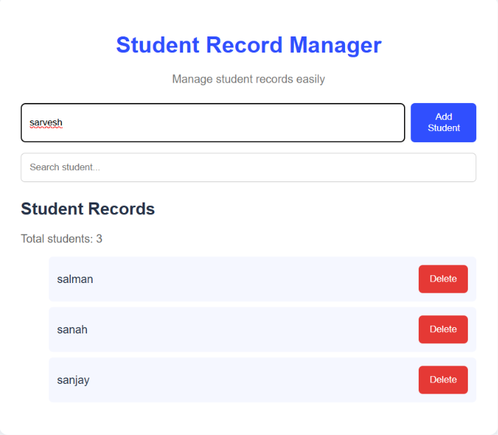
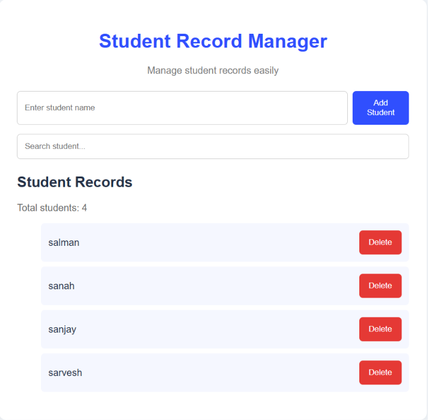
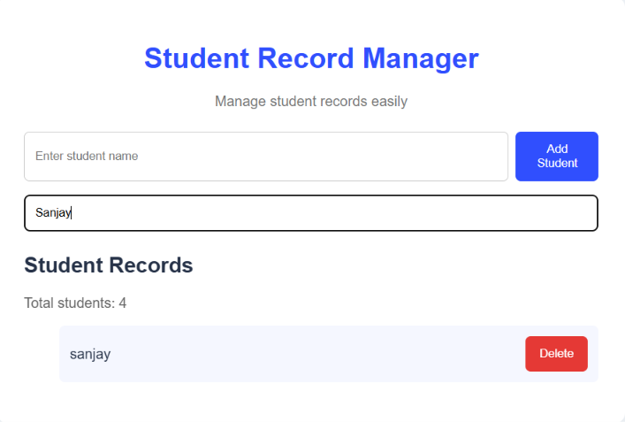

# Student Record Manager

A simple student management website built using **Java, HTML, CSS, and JavaScript**, demonstrating basic Data Structures and Algorithms.

## Features

- Add student records
- View all student records
- Search students by name
- Delete student records
- Responsive user interface

## Technologies Used

- **Java:** Backend and data management
- **ArrayList:** Stores student records
- **Linear Search:** Searches for matching student names
- **HTML:** Page structure
- **CSS:** Styling and layout
- **JavaScript:** User interactions

## Screenshots

### 1. Entering a Student Name



### 2. Displaying Student Records



### 3. Searching for a Student



## Run Locally

1. Install Java JDK 17 or later.
2. Open the project folder in a terminal.
3. Compile the Java program:

   ```bash
   javac StudentManager.java
   ```

4. Start the server:

   ```bash
   java StudentManager
   ```

5. Open `http://localhost:8081` in your browser.

## Live Demo

[Open Student Record Manager](https://njansanjay.github.io/Student-Record-Manager/)

## Limitations

Student records are stored in memory in the Java version. The GitHub Pages version uses browser storage, so records are not shared between users.

## Conclusion

This project demonstrates how ArrayList and Linear Search can be used to build a simple, practical student record management application.
